<!-- Animated Header -->

 

**🐧 Linux lover • 💻 Learning to code • 🔓 Free software enthusiast**

## 🛠️ My Skills

### 🎨 Frontend
  

### 🧰 Tools

  

### 🌱 Currently Learning

### 🎮 Languages for Fun

<picture>
  <source media="(prefers-color-scheme: dark)" srcset="https://raw.githubusercontent.com/Narges-Mahpour/Narges-Mahpour/output/pacman-contribution-graph-dark.svg">
  <source media="(prefers-color-scheme: light)" srcset="https://raw.githubusercontent.com/Narges-Mahpour/Narges-Mahpour/output/pacman-contribution-graph.svg">
  
</picture>
